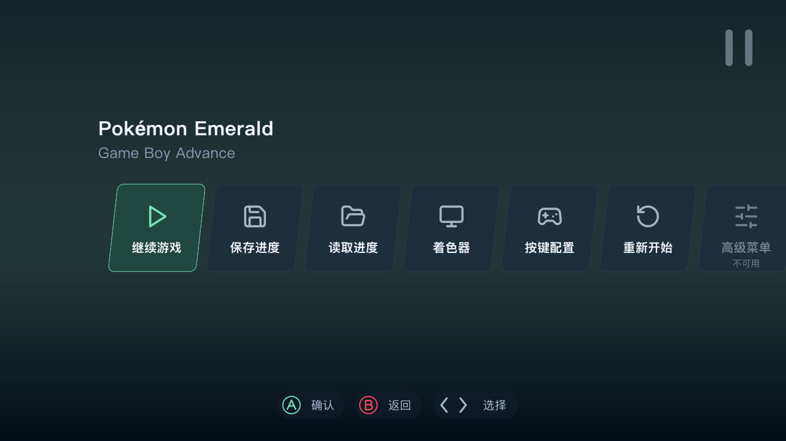

# GameGo

面向手柄操作的 RetroArch 衍生项目，提供中文卡片快捷菜单、存档预览、最近游戏、按键配置和着色器设置。

GameGo is a community fork of RetroArch focused on a controller-friendly quick menu. It is not an official RetroArch release. RetroArch and libretro retain their respective copyrights and trademarks.

## 下载与支持状态

安装包统一通过 [GitHub Releases](https://github.com/cutoolee/RetroArch/releases) 提供。请阅读对应版本的更新说明、支持状态和已知问题；尚未发布的包不代表已经可用。

| 平台 | 计划交付物 | 当前定位 |
| --- | --- | --- |
| Android ARM64 | 正式签名 APK | 首发目标；构建和验收状态见对应 Release |
| Windows x64 | 便携 ZIP | 实验性；构建和运行验收状态见对应 Release |
| Linux x64 | 便携 tar.gz | 实验性；构建和运行验收状态见对应 Release |
| macOS arm64 / x64 | 应用 ZIP | 实验性；签名、公证另列于版本说明 |
| iOS arm64 | 自签名用 IPA | 实验性；需自行签名，核心及真机验收另列于版本说明 |

完整矩阵见 [平台状态](docs/release/platforms.md)。未经过运行验收的构建不会标为稳定支持。

## 开始使用

1. 从 Releases 下载与你的平台和架构对应的包，按 `SHA256SUMS` 校验。
2. 按照 [安装指南](docs/release/install.md) 安装或解压。
3. 使用你有权使用的游戏文件和 BIOS，并安装对应的 libretro 核心。
4. 游戏中通过配置的菜单快捷键进入 GameGo 卡片菜单；复杂设置可进入高级菜单。

发行包不附带商业游戏或 BIOS。首版默认不附带第三方模拟器核心；核心按各自许可证分发，iOS 的限制见安装指南。

## 功能

- 继续游戏、保存/读取进度、重新开始和退出游戏。
- 0–9 手动存档槽位及独立的“上次退出”只读槽位。
- 最近游戏和可用媒体预览。
- 手柄按键及连发配置。
- 着色器预览、应用和取消。
- 中文显示、手柄导航与触摸操作。

## 文档

- [安装、升级和迁移](docs/release/install.md)
- [从源码构建](docs/release/build.md)
- [发布流程](docs/release/releasing.md)
- [平台支持与验收](docs/release/platforms.md)
- [更新日志](CHANGELOG.md) · [贡献指南](CONTRIBUTING.md) · [安全问题](SECURITY.md)
- [第三方版权与许可](THIRD_PARTY_NOTICES.md)
- [上游 RetroArch 说明](README.upstream.md) · [RetroArch 官方文档](https://docs.libretro.com/)

## 许可证

RetroArch 和 GameGo 的相应代码遵循仓库 [COPYING](COPYING) 中的 GNU GPLv3 及各文件原有许可声明。第三方库、字体、图标、着色器和核心保留各自许可证，不能一概视为 GPLv3。

每个二进制版本应附对应完整源码、构建脚本、资源版本和校验信息。GameGo 版本记录在 `GAMEGO_VERSION`，所基于的 RetroArch 版本记录在 `version.all`。
